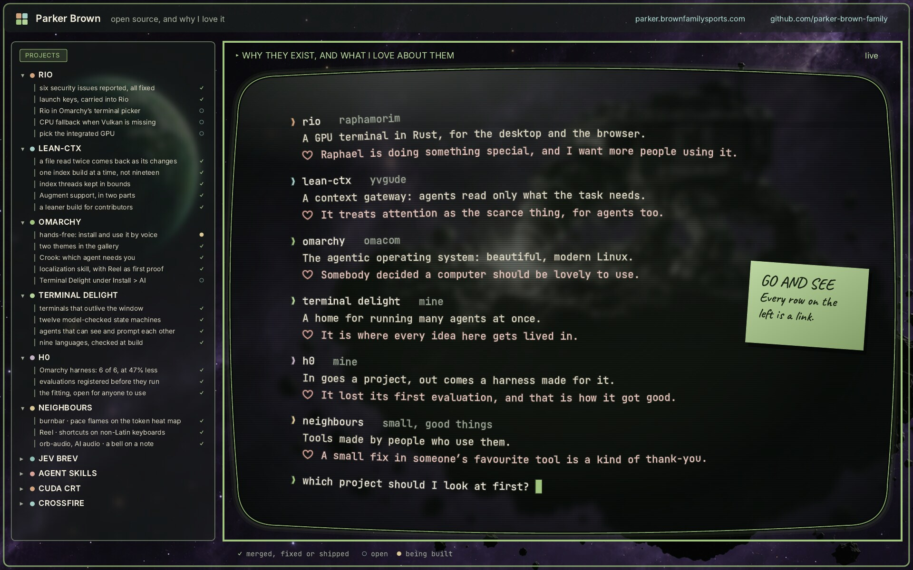
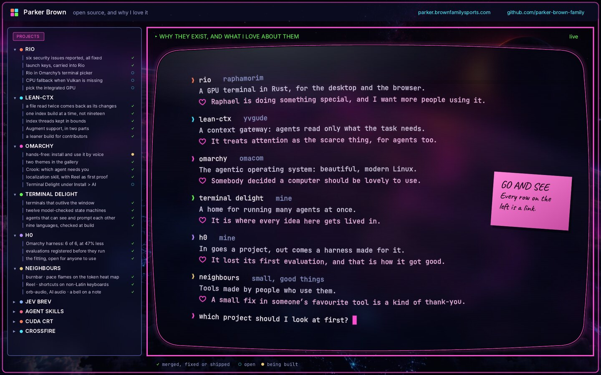

# Glass One-Pager

A skill that makes a one-page PDF of what someone builds, drawn as a terminal window with curved glass.

[](./examples/open-source/parker-brown-open-source.pdf)

**[Open the PDF](./examples/open-source/parker-brown-open-source.pdf)**: every row on the left is a link, and all of the text can be
selected. It was built from [this content file](./examples/open-source/content.json) and the Deep Quiet theme.

## Use it

Give [SKILL.md](./SKILL.md) to your agent and ask for a one-pager of your projects. Or run it yourself:

```bash
python3 scripts/onepager.py new my-page
# fill in my-page/content.json
python3 scripts/onepager.py build my-page/content.json
python3 scripts/onepager.py check my-page/content.json   # are the pull request marks still true?
```

It needs Python 3.9 or later and Chrome or Chromium. `gh` is needed only for `check`, and ImageMagick only for making a theme.

## The same page, another theme

`--theme bright-future`, with nothing else changed:



A theme is one JSON file. [How to make your own](./reference/themes.md).

## What it won't do

It won't print well, restyle itself or respond to a hover: it's a PDF. It won't build a page with a placeholder, a private link, or an email
address you haven't said is public. And `check` won't pass a pull request it couldn't read.

## Tests

```bash
python3 tests/test_onepager.py
```

## Licence

[MIT](./LICENSE). The fonts and wallpapers are credited in [CREDITS.md](./CREDITS.md).
